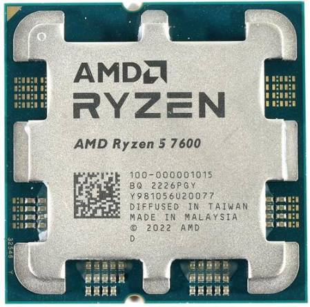
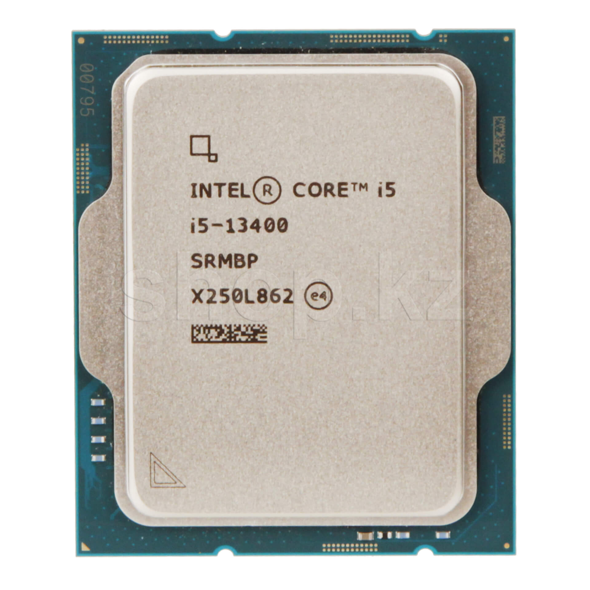
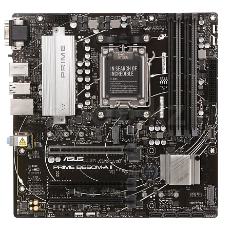
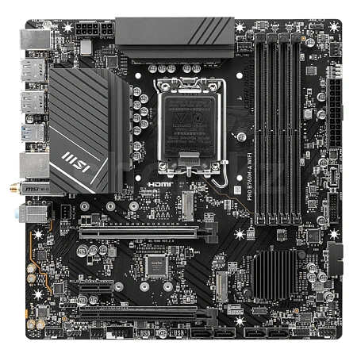
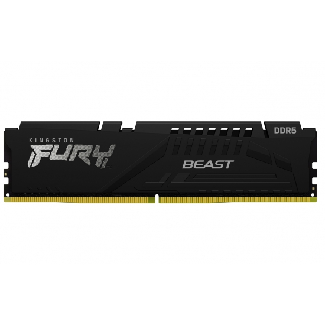
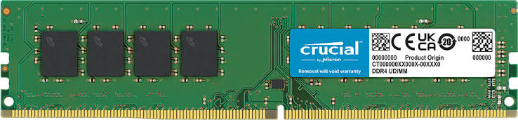
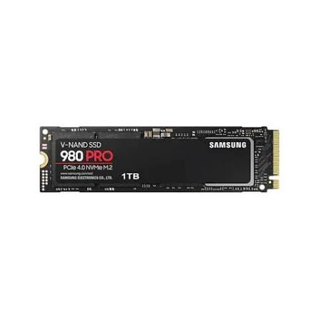
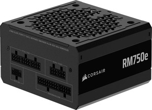
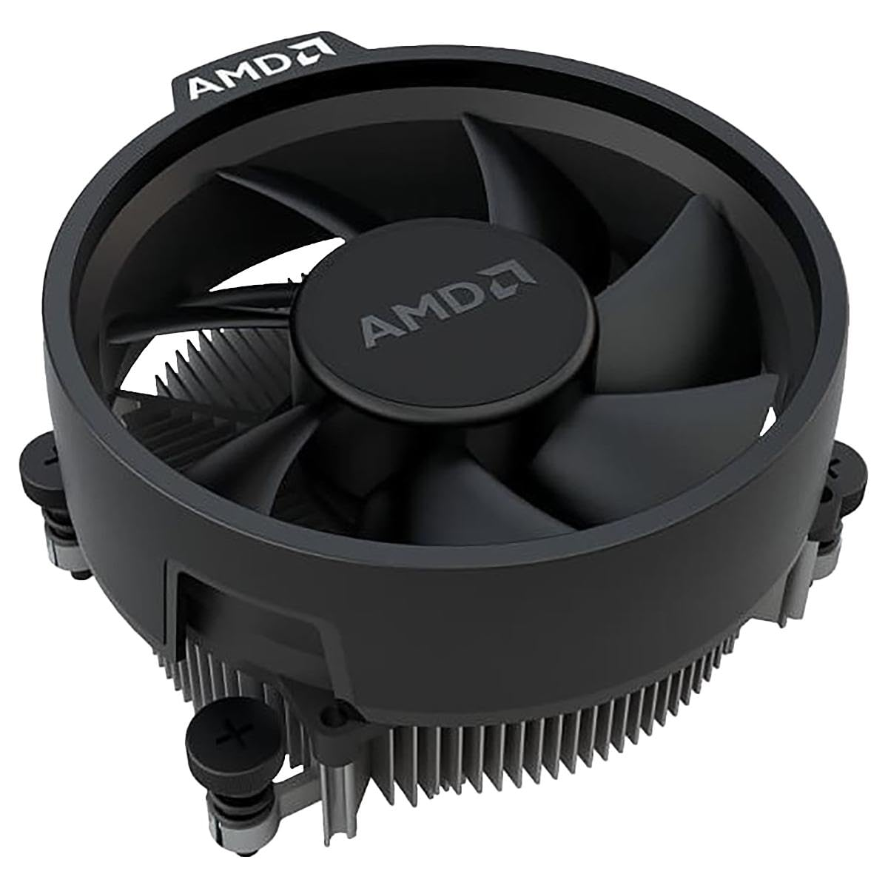

# Lab 3 — Teardown, and the same machine from the command line

Pair: Your Name + Partner Name · Date: 08 November 2026

## Part 1 — Ten parts

### Processors
**AMD Ryzen 5 7600**

Desktop CPU, 6 cores / 12 threads. Connects to: AM5 socket on the motherboard. Limit: Only works with AM5 boards and DDR5 memory. — Source: https://www.amd.com/en/products/processors/desktops/ryzen/7000-series/amd-ryzen-5-7600.html

**Intel Core i5-13400**

Desktop CPU, 10 cores (6P+4E) / 16 threads. Connects to: LGA1700 socket. Limit: Only compatible with Intel 600/700 series chipsets. — Source: https://ark.intel.com/content/www/us/en/ark/products/230495/intel-core-i5-13400-processor-20m-cache-up-to-4-60-ghz.html

### Motherboards
**ASUS PRIME B650M-A**

Micro-ATX motherboard. Connects to: Case standoffs, AM5 CPU, DDR5 RAM. Limit: Micro-ATX size offers fewer PCIe slots than full ATX.
*Specs:* Socket AM5, B650 Chipset, 4x DDR5 slots. Storage: 2x M.2 slots, 4x SATA. CPU Support: AMD Ryzen 7000 & 8000 series. — Source: https://www.asus.com/motherboards-components/motherboards/prime/prime-b650m-a/

**MSI PRO B760M-A WIFI DDR4**

Micro-ATX motherboard. Connects to: LGA1700 CPU, DDR4 RAM. Limit: DDR5 memory physically will not fit into this board.
*Specs:* Socket LGA1700, B760 Chipset, 4x DDR4 slots. Storage: 2x M.2 slots, 4x SATA. CPU Support: Intel 12th, 13th, and 14th Gen. — Source: https://www.msi.com/Motherboard/PRO-B760M-A-WIFI-DDR4/Specification

### Memory
**Kingston FURY Beast DDR5-5600, 16 GB**

DDR5 DIMM memory, 16 GB, 5600 MT/s. Connects to: DDR5 slot on a desktop motherboard. Limit: The notch prevents insertion into DDR4 slots. — Source: https://www.kingston.com/en/memory/gaming/kingston-fury-beast-ddr5-memory

**Crucial DDR4-3200, 16 GB DIMM**

DDR4 DIMM memory, 16 GB, 3200 MT/s. Connects to: DDR4 slot on a desktop motherboard. Limit: Will not fit in laptop SO-DIMM slots or DDR5 boards. — Source: https://www.crucial.com/memory/ddr4/ct16g4dfra32a

### SSDs
**Samsung 990 PRO 1 TB**

NVMe M.2 2280 SSD. Connects to: M.2 slot on the motherboard. Limit: Speed is capped if installed in an older PCIe 3.0 slot instead of 4.0. — Source: https://semiconductor.samsung.com/consumer-storage/internal-ssd/990-pro/

**Samsung 870 EVO 1 TB**

2.5-inch SATA SSD. Connects to: SATA data port on motherboard and SATA power from PSU. Limit: SATA interface limits maximum speed to ~560 MB/s. — Source: https://semiconductor.samsung.com/consumer-storage/internal-ssd/870-evo/

### Power and cooling
**Corsair RM750e (750 W)**

ATX Power Supply. Connects to: Wall socket, Motherboard (24-pin), CPU (8-pin), drives. Limit: The total peak power draw of all components cannot exceed 750W. — Source: https://www.corsair.com/us/en/p/psu/cp-9020262-na/rme-series-rm750e-fully-modular-low-noise-atx-power-supply-cp-9020262-na

**AMD Wraith Stealth (Stock Cooler)**

CPU air cooler. Ships with the Ryzen 5 7600. Connects to: AM5 socket brackets and CPU_FAN header. Limit: Only rated for 65W TDP CPUs; cannot handle extreme overclocking heat. — Source: https://www.amd.com/en/technologies/cpu-cooler-solution.html

## Two builds

### Build 1
| Part | Model | Why it fits here |
|---|---|---|
| Processor | AMD Ryzen 5 7600 | Needs an AM5 socket. |
| Cooler | AMD Wraith Stealth | Made specifically for this CPU and socket. |
| Motherboard | ASUS PRIME B650M-A | Has the AM5 socket required for the Ryzen CPU. |
| Memory | Kingston FURY Beast DDR5 | The ASUS B650 board only takes DDR5. |
| SSD | Samsung 990 PRO 1 TB | Board has PCIe 4.0 M.2 slots for full NVMe speed. |

**What this build still needs:** A Power Supply (PSU), a computer case, and an OS.

### Build 2
| Part | Model | Why it fits here |
|---|---|---|
| Processor | Intel Core i5-13400 | Needs an LGA1700 socket. |
| Motherboard | MSI PRO B760M-A WIFI DDR4 | Has the LGA1700 socket for the Intel CPU. |
| Memory | Crucial DDR4-3200 | This MSI board variant specifically requires DDR4. |
| SSD | Samsung 870 EVO 1 TB | Connects to the standard SATA ports on the board. |
| Power | Corsair RM750e (750 W) | Provides sufficient ATX power for the system. |

**What this build still needs:** A CPU cooler (unless using the Intel box cooler), a case, SATA cables, and an OS.

## Part 2 — Same facts, three operating systems

| Fact | Windows (PowerShell) | Linux (Ubuntu) | macOS |
|---|---|---|---|
| CPU model | Get-CimInstance Win32_Processor \| Select Name | lscpu | sysctl -n machdep.cpu.brand_string |
| Cores / threads | Get-CimInstance Win32_Processor \| Select NumberOfCores, NumberOfLogicalProcessors | lscpu | sysctl hw.physicalcpu hw.logicalcpu |
| Total memory | Get-CimInstance Win32_PhysicalMemory \| Select Capacity | ree -h | sysctl hw.memsize |
| Memory modules and speed | Get-CimInstance Win32_PhysicalMemory \| Select Speed, FormFactor | sudo dmidecode -t memory | system_profiler SPMemoryDataType |
| Disk model and type | Get-PhysicalDisk \| Select FriendlyName, MediaType, BusType | lsblk -d -o NAME,MODEL,ROTA,TRAN,SIZE | diskutil info disk0 |
| Free space | Get-Volume C | df -h / | df -h / |
| Architecture | $env:PROCESSOR_ARCHITECTURE | uname -m | uname -m |

**Differences:** The naming conventions differ greatly (e.g., Win32_PhysicalMemory in Windows vs dmidecode in Linux). Inside the Linux VM, the hypervisor hides the real hardware: lsblk shows a virtual disk (like VBOX HARDDISK) instead of the physical NVMe, and dmidecode cannot show the real memory speed because the VM abstracts RAM into generic blocks.

## What did not work the first time
When running dmidecode -t memory on Linux, I received a "Permission denied" error because it tries to read hardware firmware tables. I had to run it again as sudo dmidecode -t memory to make it work.

## Evidence
- evidence/windows-specs.txt — PowerShell output from Windows host.
- evidence/linux-specs.txt — Bash output from Ubuntu VM.
