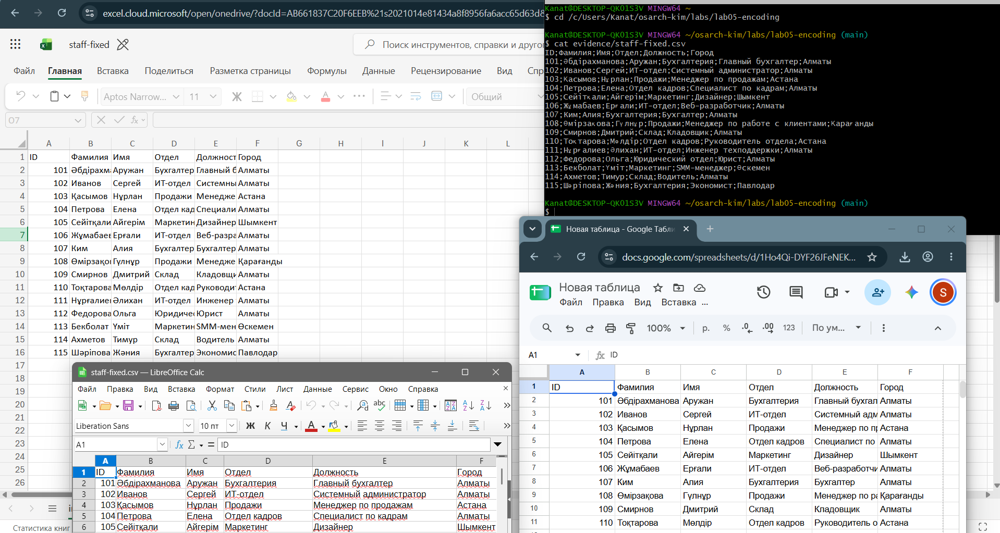

# Lab 5 - Encoding forensics

Name: Kim Amir - Date: 2026-11-12 - Tools: Windows PowerShell, Git for Windows (file, xxd, iconv), Excel, LibreOffice Calc, Git Bash

## What I received

- Excel: garbled text (mojibake) instead of the Cyrillic and Kazakh names (evidence/received-excel.png)
- LibreOffice Calc: garbled text (mojibake) instead of the Cyrillic and Kazakh names The default Character set in its import dialog was Automatic (evidence/received-libreoffice-dialog.png, evidence/received-libreoffice.png)
- Terminal (cat in Git Bash): only ID, the digits and the semicolons were readable, every letter was replaced by a block or disappeared (evidence/received-terminal.png)

## Diagnosis (made before the fix)

- file said: Non-ISO extended-ASCII text, with CRLF line terminators (evidence/file-before.txt)
- First 16 bytes: 49 44 3B D4 E0 EC E8 EB E8 FF 3B C8 EC FF 3B CE (evidence/hexdump-before.txt)
- Encoding: RK1048 (KZ-1048, the Kazakh variant of Windows-1251) - because there are no zero bytes and every Cyrillic letter is one byte between C0 and FF (the header word Familiya is D4 E0 EC E8 EB E8 FF, as in Windows-1251), but the Kazakh letters are single bytes that plain Windows-1251 reads as other letters: A3 at the start of the first name in row 101, 8D in the name of row 103, 9D in row 105, and A2, A5, BA and BF in other names. iconv from RK1048 reads every Russian and Kazakh name correctly, iconv from WINDOWS-1251 breaks the Kazakh ones, and UTF-8, UTF-16, KOI8-R and CP866 give errors or garbage
- Line ending: CRLF - because every line ends with the two bytes 0D 0A (the tool counted 16 CRLF and no lone LF), and file says with CRLF line terminators. In the fixed file I use LF, because CRLF leaves a stray carriage return at the end of the last column in Linux scripts, and Excel reads LF without problems
- BOM: no BOM - because the file starts with 49 44 (the letters ID), not with EF BB BF or FF FE. In the fixed file: I added a UTF-8 BOM (EF BB BF), because Excel on Windows recognises UTF-8 in a double-clicked CSV only when the BOM is there, and the task says the file must open correctly in Excel. The price is that a Linux script sees the three BOM bytes as part of the first column name ID
- Separator: semicolon (80 semicolons and 0 commas in the file)

## Fix

The fix is one iconv call wrapped in scripts/fix.ps1 (the script also sets the line ending and the BOM):

```powershell
powershell -ExecutionPolicy Bypass -File scripts\fix.ps1 -From RK1048 -Eol LF -Bom
```

## Verification

evidence/file-after.txt:

```
$ file evidence/staff-fixed.csv
evidence/staff-fixed.csv: Unicode text, UTF-8 (with BOM) text

$ xxd evidence/staff-fixed.csv | head -n 4
00000000: efbb bf49 443b d0a4 d0b0 d0bc d0b8 d0bb  ...ID;..........
00000010: d0b8 d18f 3bd0 98d0 bcd1 8f3b d09e d182  ....;......;....
00000020: d0b4 d0b5 d0bb 3bd0 94d0 bed0 bbd0 b6d0  ......;.........
00000030: bdd0 bed1 81d1 82d1 8c3b d093 d0be d180  .........;......
```

The fixed file opens correctly in three applications: Excel, LibreOffice Calc (import dialog with Character set Unicode UTF-8) and cat in Git Bash. All names, including the Kazakh letters, are correct in all three.



## What did not work the first time

When I tried to run cat in Git Bash, pasting the command gave bash: command not found with the strange characters ^[[200~ in front of cd. The terminal was wrapping the pasted text in bracketed paste codes, so bash treated them as part of the command. I typed the short commands by hand instead and then it worked.