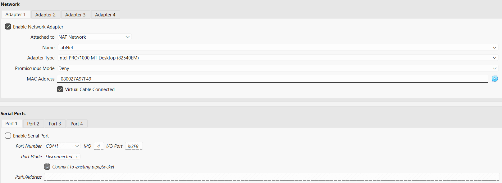
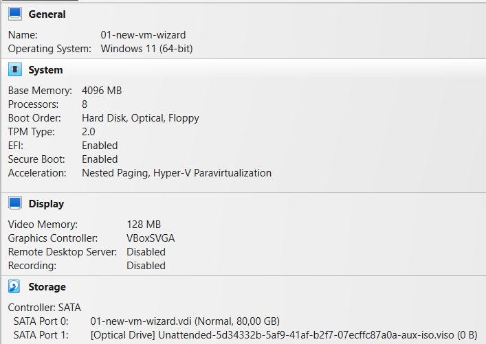
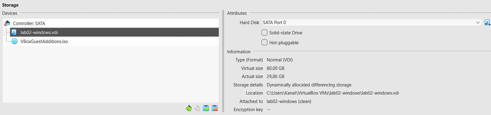
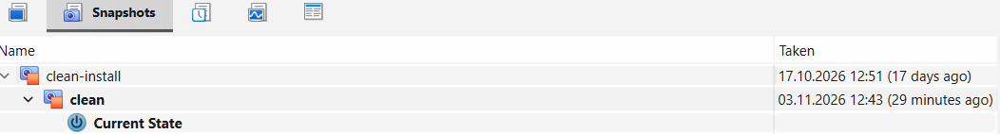

# Building a test machine: Ubuntu Server + Windows 11 in VirtualBox

**For:** Aigerim T.
**What you get:** two virtual computers ("guests") inside one laptop: Ubuntu Server (Linux) and Windows 11 Enterprise. They can reach the internet and each other. If the developer breaks one, you restore it to a clean state in a few minutes.

**You need:**
- a Windows laptop with **at least 16 GB of RAM** and **at least 150 GB of free disk** (the Windows guest alone can grow to 80 GB);
- virtualization turned on in the laptop (it is on by default on most laptops);
- internet, and about 3 hours (most of it is downloading and waiting for installers).

**Do not buy anything.** Every program below is free. If any page asks for money or a key, you are on the wrong page.

---

## Step 1. Install VirtualBox

1. Go to <https://www.virtualbox.org> → Downloads → "Windows hosts". Run the installer and keep all defaults.
2. **Do not install the "Extension Pack".**

Why: VirtualBox itself is free (GPL v3). The Extension Pack has a different licence that is free only for personal use and evaluation; a company would need to pay for it. You do not need it for this build.

> Check: open VirtualBox and choose Help → About. It shows version 7.x.

## Step 2. Download the two installer files (ISO)

1. **Ubuntu Server:** <https://ubuntu.com/download/server>. Download the current LTS version (the guest in this document runs Ubuntu 26.04.1 LTS).
2. **Windows 11 Enterprise (evaluation):** <https://www.microsoft.com/en-us/evalcenter/evaluate-windows-11-enterprise>. Choose the ISO, 64-bit, English (United States).

Why the evaluation version: it needs no product key and costs nothing. The price is that it works for about **90 days**. After that, either build a new one (this document) or buy a licence.

> Check: both files end in `.iso` and are several GB each.

## Step 3. Create one network for both guests

Menu: **File → Tools → Network Manager → NAT Networks tab → Create.** Set:

- Name: `LabNet`
- IPv4 prefix: `10.0.2.0/24`
- Enable DHCP: ticked

(Command-line equivalent: `VBoxManage natnetwork add --netname LabNet --network "10.0.2.0/24" --enable --dhcp on`.)

Why a NAT Network and not the other modes: with plain **NAT** each guest gets its own private router, so the two guests cannot see each other. **Host-only** has no internet. **Bridged** puts the guest straight onto the office network, and some networks reject such a connection. A NAT Network gives both guests internet and lets them see each other, and nothing from outside can reach them.



> Check: LabNet appears in the list with 10.0.2.0/24.

## Step 4. Create the Ubuntu virtual machine

Click **New** and use these values. The second column is the reason.

| Setting | Value | Why |
|---|---|---|
| Name | `ubuntu-test` | Any name; no spaces make commands easier. |
| ISO image | the Ubuntu Server ISO | Installer from Step 2. |
| Type / Version | Linux / Ubuntu (64-bit) | Lets VirtualBox pick suitable defaults. |
| Memory | 4096 MB | VirtualBox suggests 2048 MB, which is enough for the server itself; 4 GB gives the developer room for tools. |
| CPU | 2 | VirtualBox suggests 1. Two CPUs keep installs and updates from running on a single core; the laptop keeps the rest. |
| Disk | 25 GB, **dynamically allocated** | A dynamic disk takes only the space it really uses, not 25 GB at once. |

Then open **Settings → Network**, set "Attached to" to **NAT Network** and Name to **LabNet**.

> Check: in the VM list, ubuntu-test shows 4096 MB and 2 CPUs in its details.

## Step 5. Install Ubuntu Server

Start the VM and follow the installer. Keep the defaults, except:

1. Language and keyboard: choose yours.
2. Type of install: **Ubuntu Server** (not the minimized one).
3. Network: leave DHCP. It should show an address starting with 10.0.2.
4. Storage: use the entire disk (the "disk" is the virtual 25 GB one, not your laptop's).
5. Profile: choose a user name and a password. **Write them down.**
6. Tick **Install OpenSSH server**.
7. Do not select extra packages. When the installer finishes, choose Reboot.

> Check: after the reboot, log in and run `uname -a` and `ip -br a`. The address starts with 10.0.2.

## Step 6. Create the Windows virtual machine

Click **New**:

| Setting | Value | Why |
|---|---|---|
| Name | `windows-test` | |
| ISO image | the Windows 11 Enterprise ISO | From Step 2. |
| Type / Version | Microsoft Windows / Windows 11 (64-bit) | |
| Memory | 4096 MB | Microsoft's minimum for Windows 11 is 4 GB. |
| CPU | 8 | VirtualBox suggests 2, but on my laptop 2 CPUs were not enough to start Windows. I tried 4, then 8; 8 worked. Start with 4 on yours and raise it to 8 if Windows does not start or is very slow. |
| Disk | 80 GB, **dynamically allocated** | Microsoft's minimum is 64 GB; 80 GB leaves room for updates. |
| System → Enable EFI | ticked | Windows 11 refuses to install without EFI. |
| System → TPM | 2.0 | Windows 11 requires a TPM, and VirtualBox can pretend to have one. |
| System → Secure Boot | on | Also a Windows 11 requirement. |
| Network | NAT Network, name `LabNet` | Same network as Ubuntu, see Step 3. |





> Check: Settings → System shows EFI enabled and TPM 2.0.

## Step 7. Install Windows 11 Enterprise

1. Start the VM. When it says "Press any key to boot from CD or DVD", press a key.
2. Choose "I don't have a product key" and the edition **Windows 11 Enterprise Evaluation**.
3. Choose "Custom: install Windows only" and the only disk shown.
4. Create a user and a password. **Write them down.**
5. After the first start, in the VM menu choose **Devices → Insert Guest Additions CD image**, open the CD in Windows, run `VBoxWindowsAdditions.exe`, keep the defaults and restart. This makes the screen resize and the mouse smooth.

> Check: open Command Prompt and run `ipconfig`. The IPv4 address starts with 10.0.2.

## Step 8. Check that the two guests see each other

1. In Ubuntu, run `ip -br a`. Write down its address (for example 10.0.2.3).
2. In Windows, run `ipconfig`. Write down its address (for example 10.0.2.4).
3. In Windows run `ping <Ubuntu address>`, then `ping 1.1.1.1`.
4. In Ubuntu run `ping -c 4 <Windows address>`, then `ping -c 4 1.1.1.1`.

**If Ubuntu cannot ping Windows** (every try says 100% packet loss) while Windows can ping Ubuntu: Windows Firewall blocks ping by default. Do not turn the firewall off. Open PowerShell **as Administrator** in Windows and run one command:

```
New-NetFirewallRule -DisplayName "Allow ping in (ICMPv4)" -Protocol ICMPv4 -IcmpType 8 -Direction Inbound -Action Allow
```

Then repeat step 4.

Why: this opens only the "are you there" message (ICMP echo), not the whole computer.

> Check: "4 packets transmitted, 4 received, 0% packet loss" in both directions.

## Step 9. Take a clean snapshot, and roll back

Do this when everything works, before the developer touches anything. Shut the guest down first.

- With the mouse: select the VM, open **Snapshots** (in a Russian VirtualBox: "Снимки") and click **Take**. Name it `clean`.
- Or on the command line:
  `"C:\Program Files\Oracle\VirtualBox\VBoxManage.exe" snapshot "ubuntu-test" take clean`

To go back to clean after the developer breaks the guest: shut the guest down, then in Snapshots select `clean` and click **Restore**, or run
`"C:\Program Files\Oracle\VirtualBox\VBoxManage.exe" snapshot "ubuntu-test" restore clean`.
Everything done after the snapshot is thrown away.

Why: this is what "without breaking anything" means in practice. The laptop itself is never touched, and a broken guest is replaced in minutes.



> Check: in Ubuntu run `touch ~/test.txt`, shut down, restore `clean`, start again and run `ls ~`. The file `test.txt` is gone.

## When something goes wrong

| What you see | Why | What to do |
|---|---|---|
| Windows does not start, or is very slow, with few CPUs | Windows 11 needs more than 2 CPUs in this setup | Shut down, Settings → System → Processor, raise to 4, then to 8 |
| The two guests cannot see each other | The network adapter is plain "NAT", or the Name field is empty | Settings → Network → "Attached to: NAT Network", Name: LabNet, for both guests |
| Ubuntu cannot ping Windows but Windows can ping Ubuntu | Windows Firewall blocks ping | The firewall rule in Step 8 |
| You cannot log in to Ubuntu by SSH | The ssh service is not running | In the Ubuntu window run `sudo systemctl enable --now ssh` |
| Starting both guests makes the laptop freeze | Not enough RAM for both | Close other programs, or run only one guest at a time |
| After about 90 days Windows shows an expired-evaluation message | The evaluation ends | Build a new one with this document, or buy a Windows licence |
